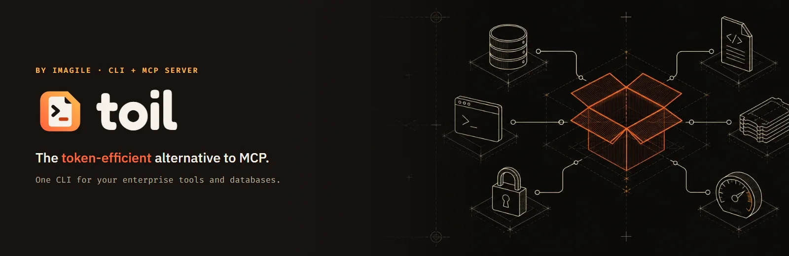

<p align="center">
  <a href="https://imagile-dev.github.io/toil/">
    
  </a>
</p>

<p align="center">
  <a href="https://www.npmjs.com/package/@imagile-dev/toil"></a>
  <a href="https://github.com/imagile-dev/toil/actions/workflows/ci.yml?query=branch%3Amain"></a>
  <a href="package.json"></a>
  <a href="https://imagile-dev.github.io/toil/how-it-works/"></a>
  <a href="LICENSE"></a>
</p>

<p align="center">
  <a href="https://imagile-dev.github.io/toil/"><b>Website</b></a> ·
  <a href="https://imagile-dev.github.io/toil/docs/"><b>Docs</b></a> ·
  <a href="https://imagile-dev.github.io/toil/how-it-works/"><b>How it works</b></a> ·
  <a href="https://imagile-dev.github.io/toil/integrations/"><b>Integrations</b></a> ·
  <a href="https://imagile-dev.github.io/toil/principles/"><b>Principles</b></a> ·
  <a href="https://imagile-dev.github.io/toil/feedback/"><b>Feedback</b></a>
</p>

The token-efficient alternative to MCP: one CLI that gives agents your enterprise
tools and your databases while spending as little of their context as it can.

- **Compact JSON envelopes.** Every command returns one `{ ok, data, error, meta }`
  envelope, so agents and scripts can use it as easily as people.
- **Only the fields you need.** `--select` trims a result to the fields a task
  names before it reaches the agent.
- **No polling loops.** `toil wait --until <expression> -- <read>` repeats a read
  until it's true and returns once.
- **A skill, not a tool list.** The `toil` skill is an index the agent reads a page
  at a time, as a task needs it, instead of every tool schema loaded up front.

`toil mcp` serves the same commands as MCP tools for clients that want them. toil is
plain JavaScript on Node, so it also runs where executables are blocked.

> **Status:** Alpha: APIs and flags may change before 1.0

toil is published to npm as [`@imagile-dev/toil`](https://www.npmjs.com/package/@imagile-dev/toil),
and documented at [imagile-dev.github.io/toil](https://imagile-dev.github.io/toil/). This
README is for working from a clone of this repository; the site covers everything else
in more depth.

### At a glance

One command, one envelope, and only the fields the task asked for. A real run of
the released `0.1.0-alpha.2`:

```console
$ toil util size package.json --select "{bytes: bytes, tokens: tokens}"
{"ok":true,"data":{"bytes":2162,"tokens":541},"error":null,"meta":{"command":"util size","durationMs":90,"version":"0.1.0-alpha.2","contractVersion":1,"warnings":[{"code":"APPROXIMATED","message":"tokens is approximate: ceil(characters / 4) per file, counting characters as Unicode code points. An estimate, not any model's tokenizer: real counts vary by model and by content."}]}}
```

The estimate says it's an estimate. Every result says where it came from and how
precise it is.

### Why toil

<p align="center">
  
</p>

<table>
  <tr>
    <td width="33%" valign="top"><b>Runs where executables can't</b><br>Plain JavaScript on Node. No binary, no native module, no install script, no runtime dependencies. Node and one npm package are all a security team has to approve.</td>
    <td width="33%" valign="top"><b>One core, three front doors</b><br>The CLI, the MCP server (<code>toil mcp</code>) and a programmatic API all run the same <code>execute()</code>, and a test proves the CLI and MCP agree on every command.</td>
    <td width="33%" valign="top"><b>Safe when an agent drives</b><br>Reads are free. A write needs <code>writes: true</code> on the connection, set by a human, and <code>--allow-write</code> on the call. Deletes are never served over MCP.</td>
  </tr>
  <tr>
    <td width="33%" valign="top"><b>Secrets stay put</b><br>Credentials come from the OS credential store or env vars, never from a plaintext file, and go only to the connection they belong to, or one you paired them with.</td>
    <td width="33%" valign="top"><b>The environment wins</b><br>CI and agents configure entirely through env vars, which override anything on disk. No repository config file can switch on writes.</td>
    <td width="33%" valign="top"><b>Honest about status</b><br>Every integration says how far it has been verified (<code>unit</code>, <code>live</code> or <code>stable</code>), and every error says what went wrong and what to do about it.</td>
  </tr>
</table>

No telemetry, no update checks, no call home: toil talks only to the hosts you
point it at. Windows, macOS and Linux are all first-class.

## Quick start

There are two ways to run toil: install it from npm, or run it from a clone. Both
need Node.js 24.14 or later, on Windows, macOS or Linux. There is no executable, no
native module and no install script.

### From npm

```bash
npm install -g @imagile-dev/toil
toil version
toil deps scan      # inventory the npm, Maven and NuGet packages in this folder
toil mcp            # serve toil to an agent over stdio
```

Releases are alpha and published under npm's `alpha` tag, which `latest` follows
until 1.0 ([npm](https://www.npmjs.com/package/@imagile-dev/toil)). Setup, connections and every command are on the
[site](https://imagile-dev.github.io/toil/docs/).

## Running from a clone

One command clones toil, builds it, adds a `toil` alias to your shell profile and
prints `toil version`:

```bash
git clone https://github.com/imagile-dev/toil.git && cd toil && node scripts/setup.mjs
```

`node scripts/setup.mjs --skip-build` uses the committed bundle with no
`npm install`, and `--no-alias` leaves your shell profile alone. Running it again is
safe. The long form follows.

`dist/toil.js` and the bundle it runs, `dist/toil-lib.js`, are committed, and they
are the last released toil, so a clone runs as it is, with no `npm install`. They
import only Node's built-ins.

```bash
git clone https://github.com/imagile-dev/toil.git
node toil/dist/toil.js version
node toil/dist/toil.js setup alias                    # bash or zsh
node toil/dist/toil.js setup alias --profile $PROFILE # PowerShell
```

`setup alias` adds a `toil` function to your shell profile, between two marker lines;
`setup remove-alias` takes it out. Open a new terminal and `toil version` works.
`git -C toil pull` brings the newest release, with nothing to rebuild.

### Building it yourself

The committed bundle changes only with a release. To run what's on `main` now, build
it:

```bash
cd toil
npm ci
npm run build       # writes dist/toil-lib.js, dist/toil.js, dist/api.js, dist/api.d.ts and the metafiles
node dist/toil.js version
```

A build rewrites the committed `dist/toil.js`, so run `git checkout -- dist/` before
`git pull`, then build again (or run `node scripts/setup.mjs`).

Don't commit the rebuilt `dist/`; `git checkout -- dist/` puts the released bundle
back. With `TOIL_BUILD_DIR` set to another folder, the build goes there and leaves
`dist/` alone, which is how Toil UI's `verify:ui` builds into `.scratch/toil`. [CLAUDE.md](CLAUDE.md) has the rest of the gate (typecheck, lint, tests).

### Pointing an agent at the clone

**MCP.** Clients start servers without a shell, so they don't see a `toil` alias.
Register `node` with the clone's absolute path:

```bash
claude mcp add toil -- node /path/to/toil/dist/toil.js mcp --areas jira
codex mcp add toil -- node /path/to/toil/dist/toil.js mcp --areas jira
```

or, for clients with an `mcpServers` file:

```json
{ "mcpServers": { "toil": { "command": "node", "args": ["/path/to/toil/dist/toil.js", "mcp", "--areas", "jira"] } } }
```

`--areas` limits the tools to what the task needs; without it toil serves every area
with a connection set up. [`skills/toil/mcp.md`](skills/toil/mcp.md) covers VS Code and
the rest.

**The toil skill.** [`skills/toil/`](skills/toil/SKILL.md) is toil's command
reference for agents, in the Agent Skills format, and the site's docs are the same
files rendered. toil carries it inside itself and installs it for your agent:

```bash
toil skill install --allow-write                  # ~/.agents/skills/toil: Codex, GitHub Copilot
toil skill install --claude --allow-write         # ~/.claude/skills/toil: Claude Code
toil skill install --agent github-copilot --scope project --allow-write
```

The installed copy names the areas you have connections for and keeps itself
current, so there is nothing to update by hand. `skill` is newer than the committed
bundle, so until the next release run it from a bundle you built (above). In Claude
Code the clone is also a plugin marketplace: `claude plugin marketplace add
/path/to/toil`, then `claude plugin install toil@toil`.
[`skills/toil/install.md`](skills/toil/install.md) has the rest.

## What it does

| Area | What it covers |
|------|----------------|
| [`db`](https://imagile-dev.github.io/toil/docs/databases/) | SQLite, PostgreSQL, MySQL / MariaDB, SQL Server and Oracle: list schemas and tables, describe a table, preview rows, read-only queries with paging |
| [`util`](https://imagile-dev.github.io/toil/docs/utilities/) | Local commands with no connection or network: JWTs, dependency inventories, encodings and hashes, certificates, test and coverage reports, logs, secret scans, time and versions, Jira and Confluence markup, OpenAPI |
| [`skills`](https://imagile-dev.github.io/toil/docs/skills/) | Add a git-hosted skills marketplace, install its plugins for Codex, GitHub Copilot or Claude Code, switch them on and off |
| [The toil skill](https://imagile-dev.github.io/toil/docs/) | toil's own command reference for agents, one file per area |
| [Work tracking and source](https://imagile-dev.github.io/toil/integrations/) (9) | Jira, Confluence and Bitbucket (Data Center and Cloud), GitHub & GitHub Enterprise, Azure DevOps Server, local git |
| [Build, release and runtime](https://imagile-dev.github.io/toil/integrations/) (5) | JFrog Artifactory, Jenkins, OpenShift / Kubernetes, Sauce Labs, Split.IO |
| [Security and quality](https://imagile-dev.github.io/toil/integrations/) (7) | Checkmarx One, Contrast Security, SD Elements, SonarQube, Sonatype IQ Server, Sonatype OSS Index, OSV.dev |
| [Observability](https://imagile-dev.github.io/toil/integrations/) (4) | Dynatrace, Elasticsearch, Kibana, Falcon LogScale |
| [Design and data](https://imagile-dev.github.io/toil/integrations/) (2) | Figma, Alation |

Every integration that needs a credential signs in with a long-lived token you
generate once in the vendor's UI. Every integration records how far it has been
verified: `unit`, `live` or `stable`. Each one's
page on the [integrations board](https://imagile-dev.github.io/toil/integrations/)
says what its level means.

## Toil UI

**Alpha, local only.** Toil UI (`@imagile-dev/toil-ui`, in [`ui/`](ui/)) is a
separate package: a local web app with one dashboard per dossier, syncing through
toil into a local cache with your own connections, read-only. It binds loopback and opens only from
the one URL it prints when it starts. Installing toil never installs it.
[`ui/README.md`](ui/README.md) and the
[docs page](https://imagile-dev.github.io/toil/docs/ui/) say how to run it.

## Contributing

Read [CLAUDE.md](CLAUDE.md). It holds the rules for people and agents alike.
[CONTRIBUTING.md](.github/CONTRIBUTING.md) is the short version: issues, branches,
the gate and how review works. Questions and bug reports go through
[SUPPORT.md](.github/SUPPORT.md), and security reports through
[SECURITY.md](.github/SECURITY.md), never a public issue.

## License

Apache License 2.0 © Imagile. See [LICENSE](LICENSE) and [NOTICE](NOTICE).
