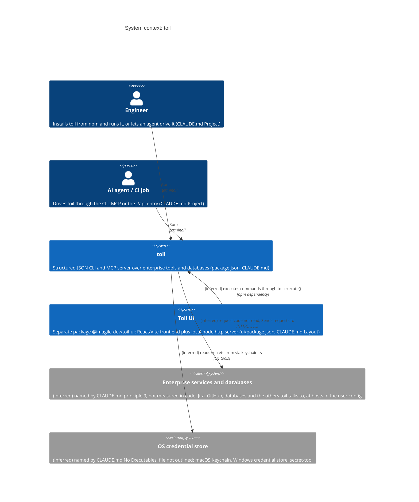

# Map of toil

A map of this repository, kept so a question about its structure reads the map instead
of the code. It was made by the workflow page `skills/toil/workflows/map-codebase.md`,
which is also how it is refreshed.

- **Commit mapped:** `333cf9ca77a624b21b1604f44946327318ba660d`
- **toil version used:** `0.1.0-beta.3`
- **Files:** [`map.json`](map.json) (modules, edges, hubs, decisions, what is not mapped)
  and [`model.json`](model.json) (the C4 model, input to `toil util c4`)
- **Diagrams (SVG):** [context](context.svg), [containers](containers.svg),
  [components](components.svg) (the components of `core`)

Everything is **observed** (read from source or a command, cited in its description) or
**inferred** (its description starts with `(inferred)` and says why). The map has 15
observed and 2 inferred modules and 19 observed and 6 inferred edges; the model has 25
observed and 3 inferred elements and 24 observed and 8 inferred relationships.
The hubs are `core` (10 modules have an edge into it) and `registry` (3).

**Not mapped:** `dist/` (generated bundle), the insides of `src/areas/*` beyond each
index file's imports, tests, `ui/` and `site/` beyond folder sizes, schema JSON, and the
services toil would read at runtime (no connection). `map.json` lists each.

## System context

## Containers

```mermaid
C4Container
title Containers: toil

Person(engineer, "Engineer", "Installs toil from npm and runs it, or lets an agent drive it (CLAUDE.md Project)")
Person(agent, "AI agent / CI job", "Drives toil through the CLI, MCP or the ./api entry (CLAUDE.md Project)")
System(toil_ui, "Toil UI", "Separate package @imagile-dev/toil-ui: React/Vite front end plus local node:http server (ui/package.json, CLAUDE.md Layout)")
System_Ext(services, "Enterprise services and databases", "(inferred) named by CLAUDE.md principle 9, not measured in code: Jira, GitHub, databases and the others toil talks to, at hosts in the user config")
System_Ext(credstore, "OS credential store", "(inferred) named by CLAUDE.md No Executables, file not outlined: macOS Keychain, Windows credential store, secret-tool")

System_Boundary(toil, "toil") {
  Container(cli, "CLI front door", "TypeScript, commander", "src/cli.ts main() and src/program.ts buildProgram; bin dist/toil.js (package.json bin)")
  Container(mcp, "MCP server", "TypeScript, MCP SDK", "src/mcp/server.ts: one tool per registry command (imported at src/cli.ts:10; tool generation per CLAUDE.md Layout)")
  Container(api, "./api entry", "TypeScript", "src/api.ts: execute(), registry, envelope types for a program in-process (src/api.ts:31 imports run.js)")
  Container(registry, "Registry", "TypeScript", "src/registry.ts lists every area and command; both front doors read it (src/registry.ts:23,34)")
  Container(core, "Core machinery", "TypeScript", "src/core: defineArea, defineCommand, execute, config, secrets, dossier, db providers, query, output (150 files, 33k lines, util size src)")
  Container(areas, "Integration areas", "TypeScript", "src/areas: 28 area folders (ls src/areas): ado, jira, github, db, util, ... 341 files, 69k lines (util size src --depth 2)")
  Container(dossiers, "Dossier commands", "TypeScript", "src/dossiers: list, show, build, onboard, brief (4 files, 1.7k lines)")
  Container(connections, "Connection commands", "TypeScript", "src/connections: add, login, list, import ... (13 files, 2.5k lines)")
  Container(skills, "Skills and bundled skill", "TypeScript", "src/skills: skills folders, marketplace clones, bundled toil skill (6 files)")
  Container(welcome, "Welcome menu", "TypeScript, ANSI", "src/welcome: splash and menu for bare toil on a terminal (38 files, 7.4k lines)")
  Container(misc, "Small modules", "TypeScript", "src/audit, feedback, theme, setup, repos, os, shims (each 1 to 4 files, imported by the root and core only)")
}

Rel(engineer, cli, "Runs", "terminal")
Rel(agent, mcp, "Calls tools on", "MCP stdio")
Rel(agent, api, "Imports and calls execute()", "npm ./api")
Rel(agent, cli, "Runs", "terminal")
Rel(cli, registry, "Builds commands from (src/cli.ts:14)", "import")
Rel(cli, core, "Runs calls through (src/program.ts:7)", "import")
Rel(cli, mcp, "Starts for toil mcp (src/cli.ts:10)", "import")
Rel(cli, welcome, "Opens on bare toil (src/cli.ts:17)", "import")
Rel(mcp, core, "Executes each tool through (util size <file> --select outline.imports over src/mcp: 14 files import ../core)", "import")
Rel(mcp, registry, "(inferred) reads tool list from", "import")
Rel(api, registry, "Exports (src/api.ts:36)", "import")
Rel(api, core, "Delegates to (src/api.ts:31)", "import")
Rel(api, mcp, "Imports (src/api.ts:34)", "import")
Rel(registry, areas, "Lists via areas.generated.ts (src/registry.ts:1)", "import")
Rel(registry, dossiers, "Registers commands of (src/registry.ts:4-7)", "import")
Rel(registry, connections, "Registers commands of (src/registry.ts:3)", "import")
Rel(registry, skills, "Registers commands of (src/registry.ts:14-15)", "import")
Rel(registry, misc, "Registers commands of (src/registry.ts:2,8,9,13,16)", "import")
Rel(areas, core, "Built on defineArea and execute (util size <file> --select outline.imports over the 15 area index.ts files: each imports ../../core)", "import")
Rel(dossiers, core, "Built on (util size <file> --select outline.imports over src/dossiers: 32 imports of ../core)", "import")
Rel(connections, core, "Built on (util size <file> --select outline.imports over src/connections: 21 imports of ../core)", "import")
Rel(skills, core, "Built on (util size <file> --select outline.imports over src/skills: 22 imports of ../core)", "import")
Rel(welcome, core, "Built on (util size <file> --select outline.imports over src/welcome: 16 imports of ../core)", "import")
Rel(misc, core, "Built on (outline.imports of 8 of 10 files, e.g. src/audit/commands.ts:2)", "import")
Rel(areas, services, "(inferred) request code not read; Sends requests to", "HTTPS, SQL")
Rel(core, credstore, "(inferred) reads secrets from via keychain.ts", "OS tools")
Rel(toil_ui, core, "(inferred) executes commands through toil execute()", "npm dependency")
```

